# Astro + Markdown Portal on Cloudflare — Technical Architecture
## 1. Executive summary

Use plain Markdown to build the website as a static digital portal. Use Astro 7 on an assets-only Cloudflare Worker. Five packages build the website. A basic entry targets approximately 0.6 KB of first-party JavaScript; code and video add the allowed scripts. Search loads Pagefind separately.

1. **Framework:** Use [Astro 7.3.8](https://www.npmjs.com/package/astro) with static output and no adapter. Astro's built-in Rust pipeline (Sätteri) processes plain Markdown (`.md`). Do not use MDX, remark plugins, rehype plugins, or Sätteri plugins.
2. **Content:** The digital portal uses the model from [Maggie Appleton](https://maggieappleton.com/garden-history). It has five sections: Notes, Experiments, Concepts, Miscellaneous, and Vault. Each entry has a Markdown folder in Git and a permanent URL at `/<slug>/`. Each entry shows its growth stage, created date, last-updated date, and topics. It also lists the entries that link to it. A Zod 4 schema checks sections, stages, topic references, cover alt text, and dates; body-image alt text remains an authoring convention. A typed `SHOW_DRAFTS` build flag controls access to drafts.
3. **UI:** Use [Accessible Astro Components 5.8.0](https://www.npmjs.com/package/accessible-astro-components) for pagination and growth-stage badges. This MIT package has no dependencies. Project CSS uses its tokens and includes callout styles; ADR-9 defines the stylesheet organization.
4. **Appearance:** Use system font stacks. Use `color-scheme` and `light-dark()` for light and dark themes. The toggle and the script that prevents a theme flash use 590 bytes of inline JavaScript.
5. **Code blocks:** Use Astro's bundled Shiki with GitHub light and dark themes as CSS variables. Include a small copy button that uses JavaScript without a framework. Include it only in entries with code.
6. **Search:** Use the [Pagefind 1.5.2](https://www.npmjs.com/package/pagefind) static index and its Component UI. Load it only on `/search/`. Supply filters for section, growth stage, and topic.
7. **SEO and feeds:** Use `@astrojs/sitemap` and `@astrojs/rss`. The RSS feed gives summaries of new entries. One head component supplies the canonical URL, Open Graph data, and JSON-LD `BlogPosting` data. Use the entry's cover as the Open Graph image. If there is no cover, use one static default image.
8. **Hosting:** Use Cloudflare Workers Static Assets with an assets-only Worker and no script. Workers builds and deploys the Worker. `wrangler.jsonc` contains its custom domain and routing configuration. Cloudflare Access protects branch previews. Only `_headers` and `_redirects` contain host rules. This permits a short migration to Pages or another static host.
9. **Security and privacy:** Use Astro's built-in hash-based CSP and header policies. The public site uses no first-party cookies or analytics scripts, and makes no third-party requests before explicit video activation. Cloudflare Access authentication on private previews is outside this public-site rule. Cloudflare's edge supplies analytics. A "Discuss on GitHub" link supplies access to comments.
10. **Tools:** Use Node 26.x and npm 11.10 or later. Disable npm install scripts and require a release age of 7 days. Use TypeScript 6 with `astro check`, and use Prettier. Pin the Wrangler version for deployments and a local server that reproduces production behavior. CI runs html-validate, lychee, Playwright with axe in both themes, and Lighthouse. Dependabot applies updates with a cooldown.

## 2. Portal Business Requirements

| Requirement | Value |
| --- | --- |
| Purpose and audience | A technical blog by developers, for developers |
| Content structure | A digital portal with five sections (Notes, Experiments, Concepts, Miscellaneous, and Vault) and visible growth stages. Topics and links organize the content instead of dates |
| Content format | Plain Markdown (`.md`), as specified in the brief; no components inside entries |
| Authors and workflow | 1–3 authors who write Markdown in a code editor and publish through pull requests |
| Scale | About 50 entries a year, under 100k page views a month |
| Required features | Topics (to replace tags), RSS, sitemap, dark mode, highlighted code blocks, site search |
| Optional features | multi-part series |
| Private content | All published entries are public, including notes. Drafts appear only in previews that authors can access |
| Domain and DNS | Custom domain with DNS managed by Cloudflare |
| Languages | English only. Thus, i18n is not applicable |
| Design requirements | Simple design with emphasis on typography; light and dark themes; no design images, use typography and css only for design, use a UI palette of at most 3 colors with at most 3 shades of each per theme; content images and syntax highlighting are exempt |
| Git host | GitHub: Actions for CI, Dependabot, Workers Builds' Git integration |
| Authorship | One author per entry. Initially use the site-wide author in `src/site.ts`; before publishing a second author, add an `authors` collection and a required author reference per entry |
| Site URL | `https://bipinpaulbedi.com` is the example site URL throughout the document. Confirm it before deployment. `https://github.com/example/blog` and `REPLACE_WITH_AUTHOR_NAME` are explicit placeholders in `src/site.ts` and must be replaced before publishing |
| Analytics requirement | Page counts and referrers are sufficient. No tracking of individual visitors |
| Section definitions | Notes: Short form notes capturing observations, ideas, and mental models that help make sense of complex topics, explore different perspectives, and develop a deeper understanding.. Experiments: claims under test, each with a confidence statement. Concepts: Essays about mental models, frameworks, and principles for understanding complex system, recognizing patterns, and approaching recurring problems with clarity and structured thinking. Miscellaneous: More, misc, meta Vault: reference material, recorded talks, and entries that no longer receive updates |

## 3. Technology summary

Each layer has one selected option. `package.json` pins the exact versions.


| Layer | Selection |
| --- | --- |
| Framework | Astro, static output, no adapter |
| Markdown | Astro's built-in Markdown on Sätteri, `.md` only |
| Content model | Digital portal: five sections (Notes, Experiments, Concepts, Miscellaneous, Vault) in one collection, with growth stages, topics and backlinks |
| Syntax highlighting | Astro's bundled Shiki, dual themes |
| UI components | Accessible Astro Components |
| Styles | Project CSS with the library's tokens, `light-dark()` |
| Fonts | System font stacks |
| Images | `astro:assets` with sharp |
| Search | Pagefind with its Component UI |
| RSS | `@astrojs/rss` |
| Sitemap | `@astrojs/sitemap` |
| Hosting | Workers Static Assets: an assets-only Worker that Workers Builds builds |
| Deployment and local server | Wrangler, pinned version |
| Preview access | Cloudflare Access on the Worker, previews only |
| Runtime | Node.js 26.x |
| Package manager | npm 11.10 or later, required for `min-release-age`; verify the bundled npm version |
| Type checking | TypeScript with `@astrojs/check` |
| Formatting | Prettier with `prettier-plugin-astro` |
| HTML validity | html-validate |
| Link checking | lychee GitHub Action |
| Accessibility tests | Playwright with axe |
| Performance tests | Lighthouse CLI |
| Dependency updates | Dependabot with `cooldown` |
| Analytics | Cloudflare edge analytics on the zone |
| Comments | "Discuss on GitHub" link per entry |

## 4. Dependency manifest

The project has fourteen direct packages. Five build the website, and nine deploy or check it. This total exceeds the ten-package target by four. Readers download only Pagefind's UI as a library, on `/search/`.

| # | Package and version | Purpose |
| --- | --- | --- |
| 1 | `astro` 7.3.8 | Build: framework |
| 2 | `@astrojs/rss` 4.0.19 | Build: RSS 2.0 feed |
| 3 | `@astrojs/sitemap` 3.7.4 | Build: sitemap index |
| 4 | `accessible-astro-components` 5.8.0 | Build: pagination, stage badge |
| 5 | `pagefind` 1.5.2 | Build: search index and UI |
| 6 | `wrangler` 4.149.0 | Deployment: production, previews; local server for CI |
| 7 | `@astrojs/check` 0.9.10 | CI: type-checks `.astro` and content |
| 8 | `typescript` 6.0.3 | CI: peer dependency of the checker |
| 9 | `prettier` 3.9.10 | CI: formatting |
| 10 | `prettier-plugin-astro` 1.1.1 | CI: formats `.astro` |
| 11 | `html-validate` 11.16.2 | CI: HTML validity |
| 12 | `@playwright/test` 1.64.0 | CI: browser tests |
| 13 | `@axe-core/playwright` 4.13.0 | CI: WCAG rules |
| 14 | `lighthouse` 13.5.0 | CI: mobile performance score |

Other dependencies are Cloudflare Workers, Workers Builds, DNS, Access, the GitHub repository, Actions, and Dependabot. Three actions have versions pinned by commit SHA: `actions/checkout` v7.0.1, `actions/setup-node` v7.1.0, and `lycheeverse/lychee-action` v2.9.0.

## 5. Architecture diagram

One repository supplies Workers Builds. It publishes a Worker Preview for each branch, with drafts protected by Access. It also publishes a production version without drafts. Readers access only static files at the edge.

```mermaid
flowchart LR
  author["Author<br/>Markdown + images in a code editor<br/>astro dev shows drafts locally"]
  bot["Dependabot<br/>7-day cooldown"]
  repo[("GitHub repository")]
  ci["GitHub Actions, every PR<br/>astro check · build · html-validate · lychee<br/>Playwright + axe and Lighthouse on wrangler dev"]
  builds["Workers Builds<br/>npm ci · astro build · pagefind"]
  preview["Worker Preview, one per branch<br/>branch-blog.subdomain.workers.dev<br/>X-Robots-Tag: noindex"]
  access{{"Cloudflare Access<br/>previews only, authors' emails"}}
  reviewer["Authors and reviewers"]
  prod["Production version<br/>assets-only Worker, no script"]
  edge["Cloudflare edge<br/>_headers · _redirects · 404.html"]
  reader["Reader's browser<br/>HTML + CSS, about 1 KB JS"]
  search["/pagefind/ index + UI<br/>same origin"]

  author -->|"push branch, open PR"| repo
  bot -->|"update PRs"| repo
  repo -->|"pull_request"| ci
  ci -->|"required checks control the merge"| repo
  repo -->|"other branches<br/>SHOW_DRAFTS=true · wrangler preview"| builds
  repo -->|"main<br/>drafts excluded · wrangler deploy"| builds
  builds --> preview
  builds --> prod
  preview --> access
  access --> reviewer
  prod --> edge
  edge -->|"https://bipinpaulbedi.com"| reader
  reader -.->|"/search/ only"| search
```



Cloudflare Access protects preview deployments and is the only authentication path. Production has no login, server code, or third-party origin.

## 6. Decisions and ADRs

| # | Decision | Recommendation |
| --- | --- | --- |
| 1 | Astro setup | Astro 7.3.8, static output, one integration (`sitemap()`). Markdown needs no integration. i18n is not applicable (English only). Upgrade policy below |
| 2 | Content model | Use `glob()` on `index.md` files for the `portal` collection. Five sections (notes, experiments, concepts, miscellaneous, vault) in one collection. All entries at `/<slug>/`. Growth stage, created and updated dates, and an epistemic note (required for experiments). Use `file()` for `topics` and `series`. Backlinks from Markdown links. 301 redirects in `_redirects` |
| 3 | Markdown authoring | Use plain `.md` with four conventions. Use links to `/<slug>/`. Use callouts as blockquotes that start with a bold phrase. Include alt text with images. Put a file name in the first-line comment of a code block. Video from frontmatter. No plugins |
| 4 | Code blocks | Built-in Shiki, `github-light` / `github-dark`, 388-byte copy button on entries with code |
| 5 | UI library and styling | Accessible Astro Components 5.8.0 plus our CSS on its tokens |
| 6 | Layouts and components | `BaseLayout`. Entry page with section, stage, dates, topics, source, table of contents, "Linked from", and "Growing nearby". The table of contents shows h2–h3 headings when there are 2+ headings. Home page with sections and topic map. Topic pages with groups by stage. One list route for the five sections, plus the recent list (20 per page). Series page. 404 |
| 7 | Typography | System stacks: Charter-class serif for body, `system-ui` for UI, `ui-monospace` for code; 68ch measure, line height 1.65, `text-wrap: pretty` |
| 8 | Theming | `color-scheme` + `light-dark()`; 216-byte head script, toggle button |
| 9 | Images | `astro:assets`, constrained layout, WebP, `srcset` 640–1200 w, also for plain Markdown images. Source files beside each entry. Required cover alt text |
| 10 | SEO and feeds | Sitemap without `/search/`. RSS summaries of new entries with type and stage labels. Static `robots.txt`. Canonical URL with an override for each entry. Open Graph. JSON-LD `BlogPosting` (published = created, modified = last updated). OG image: cover through `getImage()` at 1200×630, or one static default. No Satori |
| 11 | Search | Pagefind Component UI on `/search/` only, filtered by section, stage and topic |
| 12 | Optional features | Comments: "Discuss on GitHub" link (0 JS, 0 CSP change). Newsletter: deferred; use RSS. If added, use a plain form POST (0 JS, one `form-action` origin). The email address leaves the website on submission. Analytics: Cloudflare edge analytics (0 JS). Do not use the Web Analytics beacon. It loads a script from `static.cloudflareinsights.com` and needs a `script-src` exception ([FAQ](https://developers.cloudflare.com/web-analytics/faq/)) |
| 13 | Tools | npm with security settings in `.npmrc`, `.node-version` = 26, `astro/tsconfigs/strictest`, `astro check`, Prettier, pinned Wrangler. CI checks in §11. Dependabot with cooldown |
| 14 | Delivery | Workers Builds: `main` runs `npm run build && npx wrangler deploy`. All other branches, including Dependabot branches, run `SHOW_DRAFTS=true npm run build && npx wrangler preview`. Rollback to any of the last 100 versions |
| 15 | Security | Astro's `security.csp` (hashes in a meta tag) + `_headers`. No secrets in the repository or the build |
| 16 | Authentication | None in the app; Cloudflare Access on the Worker's previews |
| 17 | CSS organization | ITCSS-inspired native cascade layers, BEM names, Astro-scoped component styles, and small documented vendor adapters |

**Upgrade policy.** Astro released two major versions this year. The core team supplies security fixes for only one previous major version. The upgrade policy is as follows:

- Patches and minor versions: Use weekly Dependabot PRs that group `astro` and `@astrojs/*`. When CI passes, merge the PR.
- Major versions: Start within 30 days of the first patch release for the new major version. Use its "Upgrade to vX" guide. Make one PR with no other changes. Do not skip a major version.
- Do not use `experimental.*` flags without an ADR.

### ADR-1: Rendering mode and hosting target

- **Context:** The build prerenders each page. No route currently needs server code. Cloudflare's Pages documentation recommends Workers for new projects ([Pages](https://developers.cloudflare.com/pages/)). Astro's guide includes only Workers ([deploy](https://docs.astro.build/en/guides/deploy/cloudflare/)). The adapter no longer supports Pages ([adapter](https://docs.astro.build/en/guides/integrations-guide/cloudflare/)). The client initially preferred Pages but selected Workers on 2026-10-11.
- **Decision:** Use an assets-only Worker through Workers Builds to serve static output. Do not include a `main` script. `wrangler.jsonc` contains the domain and routing configuration. `_headers` and `_redirects` contain the host rules ([matrix](https://developers.cloudflare.com/workers/static-assets/migration-guides/migrate-from-pages/)). Branch previews use Worker Previews, the default for new Workers Builds projects ([previews](https://developers.cloudflare.com/workers/previews/)).

### ADR-2: A digital portal as the content model

- **Context:** The project has 1–3 authors, approximately 50 entries per year, pull requests, permanent URLs, drafts, and multi-part series. On 2026-10-11, the client requested a digital portal to replace a chronological blog. Maggie Appleton describes this model ([history and ethos](https://maggieappleton.com/garden-history)). five sections: Notes, Experiments, Concepts, Miscellaneous, and Vault.
- **Decision:** Use one `portal` collection with `glob()` over `src/content/portal/*/index.md`. `type` identifies one of the five sections in `src/site.ts`. Each entry has a URL at `/<slug>/`. A move between sections changes the data and retains the URL. An experiment must have an `epistemic` note. Any entry can include a `source` link or a `video`. `file()` loads the `topics` and `series` YAML files, which entries reference. An incorrect topic name causes build failure. Drafts render in `astro dev` or with `SHOW_DRAFTS=true`, with `noindex`.
- **Application of the six patterns:** *Topography over timelines*: The home page has sections and a topic map. Topic pages group entries by stage. Each entry has "Linked from" and "Growing nearby" lists. URLs have no dates. *Continuous growth*: Entries have `stage`, `created`, and `updated` fields. Lists use the last-update date for their sequence. A "See how this grew" link opens the entry's Git history. *Imperfection and learning in public*: Published notes show their stage. Experiments state their confidence. Entries have a "Discuss on GitHub" link. *Playful and personal*: The project uses its own CSS without a theme. *Intercropping*: One collection has five sections, with video and source links where useful. *Independent ownership*: Markdown is in Git on the project's own domain.
- **Portal and stream:** Readers use sections and topics to navigate the portal. `/recent/` is the stream and lists all entries by last significant revision (`updated ?? created`), newest first. RSS announces only new entries. An update to an entry does not send it to feed readers again.
- **Redirect policy:** A published URL must not return 404. If you rename or remove an entry, add a 301 line to `public/_redirects` in the same PR. The schema rejects a slug that a redirect already uses. `_redirects` rules have priority over a page at the same path ([redirects](https://developers.cloudflare.com/workers/static-assets/redirects/)). CI fails if a live sitemap URL disappears without a redirect.
- **Alternatives:** A chronological blog with tags gives dates priority over topics and has no section for short notes. A collection per section at `/playbooks/<slug>/` changes the URL when an entry moves. A graph view or hover previews require client JavaScript on each entry, which exceeds the 0 KB target. Wikilinks are another alternative .
- **Effects:** One flat URL space has 11 reserved names. Schema errors must cause build failure and identify the field or slug. The helpers in `site.ts` and `lib/portal.ts` replace a portal plugin. One table gives the project's interpretation of each section.
- **Review conditions:** More than approximately 40 topics: put them in groups. A sixth section: add one row to `SECTIONS`. A second author: add `authors`. More than 2,000 redirects: review the `_redirects` limit ([limits](https://developers.cloudflare.com/workers/platform/limits/#static-assets)).

### ADR-3: Markdown only, no MDX

- **Context:** The brief specified plain Markdown (`.md`). Astro 7 renders `.md` with Sätteri. GFM and smart punctuation are enabled by default. Astro adds heading IDs ([Markdown guide](https://docs.astro.build/en/guides/markdown-content/)). Sätteri has no callout syntax. Directives and optional portal wikilinks require explicit activation through `@astrojs/markdown-satteri`. The processor discards directives unless a plugin renders them ([features](https://github.com/bruits/satteri/blob/main/website/content/docs/features.md)).
- **Decision:** Use only `.md`. Do not use `@astrojs/mdx`, a `markdown.processor` override, or remark, rehype, or Sätteri plugins. Four conventions replace MDX components. Use `[text](/slug/)` for links to other entries. Use a blockquote that starts with a bold phrase for a callout. Use Markdown images with alt text and build-time optimization. Put the file name in the first-line comment of a code block. The entry route renders a video from frontmatter. `lib/portal.ts` reads links from each entry's raw body to make backlinks. It excludes top-level fenced and indented code, inline code spans, and images. Backlinks support simple inline links with plain labels; keep code fences at the top level and avoid raw HTML in entries.

### ADR-4: UI library and styling

- **Context:** The UI must use a maintained library with a permissive license. It must work in plain `.astro` without a runtime.
- **Decision:** Use Accessible Astro Components 5.8.0 for `Pagination` and `Badge` (growth stages). Its tokens define the project's spacing, type scale, and `light-dark()` colors. Project CSS adds layout, long-form prose, callouts, and portal metadata. Do not use its `DarkMode` or `SkipLink`. Their inline scripts would need CSP hashes with each release. Do not use `Video`, which loads YouTube on scroll. Do not use `Card`, which always renders an image. Its default `placehold.co` URL causes a third-party request. Since the change to Markdown, the project also does not use `Notification`.

### ADR-5: Theming

- **Context:** Light and dark themes must use `prefers-color-scheme`. The toggle must work without a framework. The incorrect theme must not appear briefly during page load.
- **Decision:** Use `:root { color-scheme: light dark }` and `light-dark()` for each color. The system setting then works with JavaScript disabled. A 216-byte inline head script applies the stored choice as `data-theme` before the first paint. Tests can supply `?theme=` instead. The toggle is a `<button aria-pressed>` that a 374-byte module script controls. It remains hidden until the script runs. `localStorage` stores the preference. No cookie stores it.
- **Design Guide:** Use a UI palette of at most three colors and three shades of each per theme. Content images and syntax highlighting are exempt. Do not use decorative images for the interface; use typography and CSS.

### ADR-6: Search

- **Context:** Search is required, with no server and no third-party service.
- **Decision:** Pagefind 1.5.2 indexes `dist/` after each build. It indexes only `data-pagefind-body` (entry bodies). Each entry puts `data-pagefind-filter` on its visible section, stage, and topic labels. `/search/` supplies these filters as dropdowns. That page loads Pagefind's Component UI. Version 1.5 introduced this UI with improved accessibility and keyboard navigation ([changelog](https://github.com/Pagefind/pagefind/blob/main/CHANGELOG.md)). Only that page adds `'wasm-unsafe-eval'` and `worker-src 'self' blob:` to its CSP, as Pagefind requires ([hosting](https://pagefind.app/docs/hosting/)).

### ADR-7: Authentication

- **Context:** All published entries are public, including notes. Only draft previews are private.
- **Decision:** Use no application authentication or authentication package. Drafts are present only in preview builds. The Worker's Access tab uses the Previews only setting. It permits access through the authors' email addresses with a one-time PIN ([Workers Access](https://developers.cloudflare.com/workers/configuration/cloudflare-access/)). `workers.dev` previews also send `X-Robots-Tag: noindex` ([previews](https://developers.cloudflare.com/workers/previews/)).
### ADR-8: Code blocks and post-page JavaScript

- **Context:** Syntax highlighting is required, and a copy button is requested. Post pages have a target of 0 KB of JavaScript unless a reason is given for more.
- **Decision:** Use built-in Shiki with `github-light`, `github-dark`, and `defaultColor: false`. CSS selects Shiki's variables with `light-dark()`. Put the file name in the first-line comment of a code block. A 388-byte progressive-enhancement script supplies the copy button. Include it only in entries with a code fence in the body. An entry's `video` loads YouTube's `youtube-nocookie.com` player only after a click. Its script uses 453 bytes and appears only in entries with a video. Without JavaScript, the video is a link.
- **CSP:** Shiki writes inline `style` attributes. Astro's CSP documentation identifies these attributes as unsupported ([config](https://docs.astro.build/en/reference/configuration-reference/#securitycsp)). Since 7.1, `style-src-attr` can restrict the scope of `'unsafe-inline'`. Thus, `<style>` elements continue to require hashes. Each build still shows Astro's warning about a Shiki and CSP conflict. This warning is expected because the restricted scope handles the conflict.


### ADR-9: CSS ownership and cascade layers

- **Context:** a maintainable CSS architecture while preserving the existing design and behavior. The global stylesheet had accumulated page-specific rules, structural selectors, and homepage grid overrides.
- **Decision:** Retain plain CSS, system fonts, the existing palette, and Accessible Astro Components. Use a lightweight ITCSS/BEM hybrid: ordered `tokens`, `reset`, `base`, `layout`, `components`, and `utilities` cascade layers; descriptive `block__element` / `block--modifier` names; `l-` layout classes; and `u-` utilities. Keep shared foundations in `src/styles/`, and move local styles to their owning Astro components/routes. Import the canonical layer order at each CSS entry point so Astro's emitted stylesheet order does not establish a different cascade. Scope Markdown descendants to the entry's prose root.
- **Integration boundary:** Accessible Astro Components and Pagefind emit unlayered styles. Keep narrowly documented unlayered adapters for Badge appearance, the package's native-button typography reset, and Pagefind theme variables/color-scheme. Keep hidden/reduced-motion safeguards. Do not increase specificity or add `!important` to ordinary component rules to compete with vendor CSS.

## 7. Content model

Each post is now a digital portal entry in plain Markdown. Maggie Appleton describes the digital portal model ([history and ethos](https://maggieappleton.com/garden-history)). The five sections are Notes, Experiments, Concepts, Miscellaneous, and Vault. Topics and links connect entries instead of dates. Each entry shows its completion stage. Its folder uses its permanent slug as its name and contains `index.md` and images. All sections serve entries at `/<slug>/`. Build tests must confirm rejection of reserved or redirected slugs, unknown sections, unknown stages, and unknown topics. They must also reject an experiment without a nonempty epistemic note. Each rejection must identify the cause. Date coercion checks valid date values and ordering; `YYYY-MM-DD` input and nonempty alt text in Markdown bodies are authoring conventions, not enforced by this schema.

```ts
// src/content.config.ts — Astro 7: loaders from astro/loaders, Zod 4 from astro/zod
import { readFileSync } from 'node:fs';
import { defineCollection, reference } from 'astro:content';
import { file, glob } from 'astro/loaders';
import { z } from 'astro/zod';
import { SECTIONS, SECTION_IDS } from './site';

// All entries use /<slug>/. These routes and build folders share the same flat URL space.
// Kebab-case excludes file names such as rss.xml.
const ROUTES = ['404', 'pagefind', 'recent', 'search', 'series', 'topics'];
const RESERVED = [...ROUTES, ...Object.values(SECTIONS).map((s) => s.path)];
// Do not reuse a retired slug. A _redirects rule has priority over a page at the same path.
const RETIRED =
  readFileSync('./public/_redirects', 'utf8')
    .match(/^\/[a-z0-9-]+(?=\/?\s)/gm)
    ?.map((s) => s.slice(1)) ?? [];
const kebab = /^[a-z0-9]+(?:-[a-z0-9]+)*$/;

const portal = defineCollection({
  // src/content/portal/<slug>/index.md -> /<slug>/ in all sections. The slug is permanent.
  // A note can become an experiment. The section is data and is not part of the URL.
  loader: glob({
    base: './src/content/portal',
    pattern: '*/index.md',
    generateId: ({ entry }) => {
      const slug = entry.split('/')[0]!;
      if (!kebab.test(slug) || RESERVED.includes(slug) || RETIRED.includes(slug)) {
        throw new Error(
          `"${slug}" is not a valid portal slug: use kebab-case, no reserved route (${RESERVED.join(', ')}), no redirected old slug`,
        );
      }
      return slug;
    },
  }),
  schema: ({ image }) =>
    z
      .object({
        type: z.enum(SECTION_IDS), // intercropping: one portal, five sections
        title: z.string().min(1).max(90),
        description: z.string().min(50).max(160),
        stage: z.enum(['abstract', 'evolving', 'accepted']), // completion stage, visible to readers
        created: z.coerce.date(), // first published
        updated: z.coerce.date().optional(), // last significant revision
        topics: z.array(reference('topics')).min(1).max(5), // topography: each topic must exist
        epistemic: z.string().trim().min(1).max(160).optional(), // confidence, effort, sources; required for experiments
        draft: z.boolean().default(false), // unpublished: preview builds only; notes are published
        cover: z.object({ src: image(), alt: z.string().min(1) }).optional(),
        canonicalUrl: z.url().optional(),
        source: z.url().optional(), // target URL for a note or vault entry
        video: z
          .string()
          .regex(/^[\w-]{11}$/)
          .optional(), // YouTube ID; player loads only after a click
        series: z.object({ id: reference('series'), part: z.number().int().positive() }).optional(),
      })
      .refine((d) => !d.updated || d.updated >= d.created, {
        message: 'updated must not be earlier than created',
        path: ['updated'],
      })
      .refine((d) => d.type !== 'experiment' || Boolean(d.epistemic), {
        message: 'an experiment needs an epistemic note: confidence and conditions that would change it',
        path: ['epistemic'],
      }),
});

const topics = defineCollection({
  loader: file('./src/content/topics.yaml'),
  schema: z.object({ title: z.string(), description: z.string().max(200) }),
});

const series = defineCollection({
  loader: file('./src/content/series.yaml'),
  schema: z.object({ title: z.string(), description: z.string() }),
});

export const collections = { portal, topics, series };
```

`src/site.ts` contains the five sections. The schema, menu, list pages, and reserved slugs all use this table. Labels, descriptions, and new section definitions are centralized here. Renaming a key also requires migrating entry `type` values; renaming a path requires 301 redirects for the old list URLs, including paginated URLs. Update the authoring instructions when the section definitions change.

```ts
// src/site.ts
/** The five portal sections in menu sequence. Each entry belongs to exactly one section. */
export const SECTIONS = {
  note: {
    path: 'notes',
    label: 'Notes',
    title: 'Notes',
    blurb:
      'Short form notes capturing observations, ideas, and mental models that help make sense of complex topics, explore different perspectives, and develop a deeper understanding.',
  },
    experiment: {
    path: 'experiments',
    label: 'Experiments',
    title: 'Experiments',
    blurb:
      'A collection of ideas, hypotheses, and assumptions put to the test through exploration and experimentation.',
  },
    concept: {
    path: 'concepts',
    label: 'Concepts',
    title: 'Concepts',
    blurb: 'Essays about mental models, frameworks, and principles for understanding complex system, recognizing patterns, and approaching recurring problems with clarity and structured thinking.',
  },
    miscellaneous: {
    path: 'miscellaneous',
    label: 'Miscellaneous',
    title: 'Miscellaneous',
    blurb: 'More, misc, meta',
  },
  vault: {
    path: 'vault',
    label: 'Vault',
    title: 'Vault',
    blurb: 'Reference material: sources, recorded talks, and entries that no longer receive updates.',
  },
} as const;
export type Section = keyof typeof SECTIONS;
export const SECTION_IDS = Object.keys(SECTIONS) as [Section, ...Section[]];

/** Portal source location. Entries link to their Git history and discussions here. */
export const REPO = 'https://github.com/example/blog'; // replace before publishing
export const AUTHOR_NAME = 'REPLACE_WITH_AUTHOR_NAME'; // sole author until an authors collection is added
export const historyUrl = (id: string) => `${REPO}/commits/main/src/content/portal/${id}/index.md`;
export const discussUrl = (title: string) =>
  `${REPO}/discussions?discussions_q=${encodeURIComponent(title)}`;
```

````ts
// src/lib/portal.ts — the only draft filter and the location of backlink processing
import { getCollection, type CollectionEntry } from 'astro:content';
import { SHOW_DRAFTS } from 'astro:env/server';

export type Entry = CollectionEntry<'portal'>;
export type Stage = Entry['data']['stage'];

/** Drafts render in `astro dev` and preview builds (SHOW_DRAFTS=true). They never render in production. */
export const showDrafts = import.meta.env.DEV || SHOW_DRAFTS;

export async function getPortal(): Promise<Entry[]> {
  return getCollection('portal', ({ data }) => showDrafts || !data.draft);
}

export const entryUrl = (entry: Entry) => `/${entry.id}/`;
export const lastUpdated = (entry: Entry) => entry.data.updated ?? entry.data.created;
export const byUpdated = (a: Entry, b: Entry) => lastUpdated(b).valueOf() - lastUpdated(a).valueOf();

// Backlinks support simple inline links with plain labels and trailing-slash URLs.
// Keep code fences at the top level; nested code blocks and raw HTML are outside this subset.
const internalLink = /(?<!!|\\)\[[^\[\]\n]+\]\(\/([a-z0-9]+(?:-[a-z0-9]+)*)\/(?:#[^)\s]*)?\)/g;

export function linksFrom(entry: Entry): string[] {
  let fence: string | undefined;
  const lines = (entry.body ?? '').split('\n').map((line) => {
    if (fence) {
      const closing = line.match(/^ {0,3}(`+|~+)\s*$/)?.[1];
      if (closing && closing[0] === fence[0] && closing.length >= fence.length) fence = undefined;
      return '';
    }
    const opening = line.match(/^ {0,3}(`{3,}|~{3,})(.*)$/);
    if (opening && !(opening[1]![0] === '`' && opening[2]!.includes('`'))) {
      fence = opening[1];
      return '';
    }
    return /^(?: {4}|\t)/.test(line) ? '' : line;
  });
  let prose = lines.join('\n');
  // A code span closes only at a backtick run of the same length.
  const runs = [...prose.matchAll(/`+/g)];
  for (let i = 0; i < runs.length; i++) {
    const open = runs[i]!;
    const closeIndex = runs.findIndex((run, j) => j > i && run[0].length === open[0].length);
    if (closeIndex < 0) continue;
    const end = runs[closeIndex]!.index! + runs[closeIndex]![0].length;
    const start = open.index!;
    prose = prose.slice(0, start) + ' '.repeat(end - start) + prose.slice(end);
    i = closeIndex;
  }
  return [...new Set([...prose.matchAll(internalLink)].map((m) => m[1]!))];
}

export function backlinks(portal: Entry[]): Map<string, Entry[]> {
  const inbound = new Map<string, Entry[]>();
  for (const from of portal) {
    for (const to of linksFrom(from)) {
      if (to !== from.id) inbound.set(to, [...(inbound.get(to) ?? []), from]);
    }
  }
  return inbound;
}

/** Entries with the most shared topics, then by latest revision. `skip` prevents repeated backlinks. */
export function related(entry: Entry, portal: Entry[], skip: Entry[] = [], limit = 4): Entry[] {
  const mine = new Set(entry.data.topics.map((t) => t.id));
  return portal
    .filter((other) => other.id !== entry.id && !skip.includes(other))
    .map((other) => ({ other, shared: other.data.topics.filter((t) => mine.has(t.id)).length }))
    .filter(({ shared }) => shared > 0)
    .sort((a, b) => b.shared - a.shared || byUpdated(a.other, b.other))
    .slice(0, limit)
    .map(({ other }) => other);
}
````

```yaml
# src/content/topics.yaml — the portal map; an entry with another topic causes build failure
- id: astro
  title: Astro
  description: Content websites with Astro, from content collections to deployments.
- id: cloudflare
  title: Cloudflare
  description: Static and edge workloads on Cloudflare's developer platform.
- id: web-platform
  title: The web platform
  description: Native browser functions and the JavaScript that they make unnecessary.
- id: portal
  title: portal
  description: The organization, maintenance, and development of this portal.

# src/content/series.yaml
- id: astro-on-cloudflare
  title: Astro on Cloudflare
  description: A three-part series about deployment of a static Astro website to Cloudflare.
```

Sample entry, `src/content/portal/static-astro-on-cloudflare/index.md`: an evergreen note. The callout is a blockquote that starts with a bold phrase. The image uses plain Markdown with build-time optimization. The code block gives its file name in a first-line comment.

````md
---
type: note
title: Deploy a static Astro portal to Cloudflare
description: This portal uses Astro 7, plain Markdown, and very little client JavaScript. An assets-only Cloudflare Worker serves it.
stage: abstract
created: 2026-09-14
updated: 2026-10-08
topics: [astro, cloudflare]
epistemic: A reference project supplied build results and measurements. Browser tests have not run.
cover:
  src: ./cover.png
  alt: Diagram of a Git push, a build, and delivery to Cloudflare's edge
series:
  id: astro-on-cloudflare
  part: 1
---

## Why static

The build makes each page into HTML. Thus, an assets-only Worker serves only files.

> **Production excludes drafts.** An entry with `draft: true` appears only in preview builds. Cloudflare Access protects these builds.

Build pipeline from Git to Cloudflare's edge

```js
// astro.config.mjs
export default defineConfig({ site: 'https://bipinpaulbedi.com' });
```

[^1]: Astro's Markdown pipeline includes footnotes, tables, and task lists.
````

The linked note, `assets-only-workers`, links back with `[How this portal ships](/static-astro-on-cloudflare/#why-static)`. Thus, each entry lists the other under "Linked from". A published note shows its stage. `draft: true` excludes an entry from production builds. ADR-2 relates Maggie Appleton's six portal patterns and the five sections to these fields.

## 8. Project structure

Authors work only in `src/content/`. Each entry has one folder under `portal/`. Two short YAML files contain topics and series. `src/site.ts` contains the five sections. All other changes use the usual code review process.

```text
.
├── .github/
│   ├── workflows/ci.yml       # PR checks: check, build, HTML, links, axe in both themes, Lighthouse
│   └── dependabot.yml         # weekly npm and Actions updates with a cooldown
├── docs/architecture.md       # this exported document; coding agents read one section at a time
├── public/                    # copies without changes: _headers, _redirects, robots.txt, favicon.svg, og-default.png
├── scripts/                   # CI helpers only (lighthouse.mjs); the build runs none of these scripts
├── src/
│   ├── components/            # BaseHead, ThemeInit, ThemeToggle, CopyCode, Video (loads after a click)
│   │   └── portal/            # GrowthStage, PortalMeta, EntryCard, EntryIndex, Backlinks
│   ├── content/
│   │   ├── portal/<slug>/     # one folder per entry: index.md and its images
│   │   ├── topics.yaml        # portal map: all permitted topics for entries
│   │   ├── series.yaml        # multi-part series; entries supply their part number
│   │   └── AGENTS.md, CLAUDE.md # authoring rules for coding agents
│   ├── layouts/               # BaseLayout: document shell, header and primary navigation, footer
│   ├── lib/portal.ts          # draft filter, URLs, last-updated sequence, backlinks, related entries
│   ├── pages/
│   │   ├── index.astro        # sections, topic map, recently updated entries, evergreens
│   │   ├── [slug].astro       # all entries at /<slug>/, independent of section (below)
│   │   ├── [section]/         # [...page].astro: /notes/ to /vault/, by last-updated date, 20 per page
│   │   ├── recent/            # [...page].astro: the stream, all entries by last-updated date
│   │   ├── topics/            # index.astro: the map with counts; [topic].astro: entries grouped by stage
│   │   ├── series/[id].astro  # one series in part order
│   │   ├── search.astro       # Pagefind's UI with section, stage and topic filters
│   │   ├── rss.xml.ts         # new entries only; updates never send an entry again
│   │   └── 404.astro
│   ├── styles/global.css      # tokens, themes, prose, callouts, code blocks, portal metadata
│   ├── site.ts                # five sections and the repository URL and default author (§7)
│   └── content.config.ts      # collections and schemas (§7)
├── tests/                     # Playwright tests: accessibility, budgets, privacy, CSP, headers, permanent URLs
├── AGENTS.md                  # for all coding agents: commands, mandatory rules, usual changes
├── CLAUDE.md                  # imports AGENTS.md, plus notes for Claude Code
├── astro.config.mjs
├── wrangler.jsonc             # the Worker: assets directory, 404 and slash handling, custom domain, previews
├── playwright.config.ts
├── tsconfig.json              # extends astro/tsconfigs/strictest
├── package.json, package-lock.json
├── .node-version              # 26
├── .npmrc                     # engine-strict, ignore-scripts, min-release-age, save-exact
├── .prettierrc.json, .prettierignore
└── .htmlvalidate.json
```

There is no Worker script or `functions/` directory. The Worker serves only files. Thus, any static host can use `dist/` without changes.

All entries use the `src/pages/[slug].astro` route, independent of section. `getStaticPaths` calculates backlinks and related entries once per build. Frontmatter supplies video data. Only entries with code include the copy button.

````astro
---
import { getEntries, getEntry, render } from 'astro:content';
import { getImage } from 'astro:assets';
import BaseLayout from '../layouts/BaseLayout.astro';
import PortalMeta from '../components/portal/PortalMeta.astro';
import Backlinks from '../components/portal/Backlinks.astro';
import CopyCode from '../components/CopyCode.astro';
import Video from '../components/Video.astro';
import { backlinks, entryUrl, getPortal, lastUpdated, related, type Entry } from '../lib/portal';
import { AUTHOR_NAME, SECTIONS, discussUrl, historyUrl } from '../site';

export async function getStaticPaths() {
  const portal = await getPortal();
  const inbound = backlinks(portal);
  return portal.map((entry) => {
    const linkedFrom = inbound.get(entry.id) ?? [];
    return {
      params: { slug: entry.id },
      props: { entry, linkedFrom, nearby: related(entry, portal, linkedFrom) },
    };
  });
}

interface Props {
  entry: Entry;
  linkedFrom: Entry[];
  nearby: Entry[];
}
const { entry, linkedFrom, nearby } = Astro.props;
const { Content, headings } = await render(entry);
const topics = await getEntries(entry.data.topics);
// reference('series') transforms the frontmatter ID into { collection, id }.
const series = entry.data.series ? await getEntry(entry.data.series.id) : undefined;
const og = entry.data.cover
  ? await getImage({ src: entry.data.cover.src, width: 1200, height: 630, format: 'jpg' })
  : undefined;
const url = new URL(entryUrl(entry), Astro.site).href;
const jsonLd = {
  '@context': 'https://schema.org',
  '@type': 'BlogPosting',
  headline: entry.data.title,
  description: entry.data.description,
  datePublished: entry.data.created.toISOString(),
  dateModified: lastUpdated(entry).toISOString(),
  mainEntityOfPage: url,
  keywords: topics.map((t) => t.data.title).join(', '),
  ...(og ? { image: new URL(og.src, Astro.site).href } : {}),
  author: { '@type': 'Person', name: AUTHOR_NAME },
};
const toc = headings.filter((h) => h.depth === 2 || h.depth === 3);
const section = SECTIONS[entry.data.type];
const seriesLabel = series && `${series.data.title}, part ${entry.data.series!.part}`;
const hasCode = /^ {0,3}(?:`{3,}|~{3,})/m.test(entry.body ?? ''); // only entries with code include the copy button
---

<BaseLayout
  title={entry.data.title}
  description={entry.data.description}
  canonical={entry.data.canonicalUrl}
  ogImage={og?.src}
  jsonLd={jsonLd}
>
  <article class="prose" data-pagefind-body>
    <header>
      <p class="kicker">
        <a href={`/${section.path}/`} data-pagefind-filter="section">
          {section.label}
        </a>
        {series && <a href={`/series/${series.id}/`}>{seriesLabel}</a>}
      </p>
      <h1>{entry.data.title}</h1>
      <PortalMeta entry={entry} topics={topics} />
    </header>
    {entry.data.video && <Video id={entry.data.video} title={entry.data.title} />}
    {toc.length > 1 && (
      <nav aria-label="On this page" data-pagefind-ignore>
        <ol>
          {toc.map((h) => (
            <li>
              <a href={`#${h.slug}`}>{h.text}</a>
            </li>
          ))}
        </ol>
      </nav>
    )}
    <Content />
    {hasCode && <CopyCode />}
  </article>
  <aside class="portal-links" aria-label="Connections" data-pagefind-ignore>
    <Backlinks title="Linked from" entries={linkedFrom} />
    <Backlinks title="Growing nearby" entries={nearby} />
    <ul class="inline-list">
      <li>
        <a href={historyUrl(entry.id)}>See how this grew</a>
      </li>
      <li>
        <a href={discussUrl(entry.data.title)}>Discuss on GitHub</a>
      </li>
    </ul>
  </aside>
</BaseLayout>
````

`src/pages/[section]/[...page].astro` builds all five section lists from `SECTIONS`, with 20 entries per page. An empty section still has a page. That page states that there are no entries yet.

```astro
---
import type { GetStaticPaths, InferGetStaticPropsType } from 'astro';
import EntryIndex from '../../components/portal/EntryIndex.astro';
import { byUpdated, getPortal } from '../../lib/portal';
import { SECTIONS, SECTION_IDS } from '../../site';

export const getStaticPaths = (async ({ paginate }) => {
  const portal = (await getPortal()).sort(byUpdated);
  return SECTION_IDS.flatMap((type) =>
    paginate(
      portal.filter((e) => e.data.type === type),
      { params: { section: SECTIONS[type].path }, props: { type }, pageSize: 20 },
    ),
  );
}) satisfies GetStaticPaths;

type Props = InferGetStaticPropsType<typeof getStaticPaths>;
const { page, type } = Astro.props;
const { title, blurb } = SECTIONS[type];
---

<EntryIndex title={title} description={blurb} page={page} />
```

## 9. Configuration skeletons

**`astro.config.mjs`**

```js
// @ts-check
import { defineConfig, envField } from 'astro/config';
import sitemap from '@astrojs/sitemap';

export default defineConfig({
  site: 'https://bipinpaulbedi.com',
  trailingSlash: 'always',
  build: { format: 'directory' },
  integrations: [sitemap({ filter: (page) => !page.endsWith('/search/') })],
  env: {
    schema: {
      // true only in preview builds; the Workers Builds preview command sets it
      SHOW_DRAFTS: envField.boolean({ context: 'server', access: 'public', default: false }),
    },
  },
  markdown: {
    // Sätteri remains the default processor: no `processor` override or plugins
    shikiConfig: {
      themes: { light: 'github-light', dark: 'github-dark' },
      defaultColor: false, // CSS selects the theme with light-dark()
    },
  },
  image: { layout: 'constrained', responsiveStyles: true },
  security: {
    csp: {
      directives: [
        "default-src 'self'",
        "img-src 'self'",
        "font-src 'self'",
        "connect-src 'self'",
        'frame-src https://www.youtube-nocookie.com',
        "object-src 'none'",
        "base-uri 'self'",
        "form-action 'self'",
        'upgrade-insecure-requests',
      ],
      scriptDirective: {
        resources: ["'self'"], // Keep this. Otherwise, insertScriptResource() on a page removes it.
        // SHA-256 of the inline script in src/components/ThemeInit.astro. Any CSP violation causes CI failure.
        hashes: ['sha256-WFV5CGAhIjttYr+w3I/IwiROnjgt2MLXBxmNb9oMRwg='],
      },
      styleDirective: {
        resources: [
          { resource: "'self'", kind: 'element' },
          { resource: "'unsafe-inline'", kind: 'attribute' }, // Shiki's style attributes only (Astro 7.1+)
        ],
      },
    },
  },
});
```

**`src/components/ThemeInit.astro`** (renders inside `<head>`; its exact text produces the hash above)

```astro
<!-- prettier-ignore -->
<script is:inline>(function(){try{var q=new URLSearchParams(location.search).get('theme');var t=q==='light'||q==='dark'?q:localStorage.getItem('theme');if(t==='light'||t==='dark')document.documentElement.dataset.theme=t}catch(e){}})()</script>
```

`src/pages/search.astro` adds exceptions only to its own policy. It uses `Astro.csp?.insertScriptResource("'wasm-unsafe-eval'")` and `Astro.csp?.insertDirective("worker-src 'self' blob:")` ([CSP API](https://docs.astro.build/en/reference/api-reference/#csp)). The page contains Pagefind's input, results, and three filter dropdowns (section, stage, topic). A `<noscript>` link opens the topic map.

**`wrangler.jsonc`** (validate with `wrangler deploy --dry-run` and local `wrangler dev` when the implementation exists):

```jsonc
{
  "$schema": "./node_modules/wrangler/config-schema.json",
  "name": "blog",
  "compatibility_date": "2026-10-01",
  // Assets-only Worker: no "main" script. Each request is a free static-asset request.
  "assets": {
    "directory": "./dist",
    "not_found_handling": "404-page",
    "html_handling": "auto-trailing-slash",
  },
  // Production uses only the custom domain. Previews use workers.dev URLs with X-Robots-Tag: noindex.
  "routes": [{ "pattern": "bipinpaulbedi.com", "custom_domain": true }],
  "workers_dev": false,
  "preview_urls": true,
}
```

**Workers Builds and dashboard settings**

| Setting | Value |
| --- | --- |
| Source | Workers Builds, Git integration with the GitHub repository |
| Production branch | `main` |
| Build command | Empty. The two commands below do the build |
| Deploy command | `npm run build && npx wrangler deploy` |
| Preview builds | Enabled. Preview command: `SHOW_DRAFTS=true npm run build && npx wrangler preview`. All other branches build, including Dependabot branches |
| Build variables | None. They apply to all branches. Thus, the preview command sets `SHOW_DRAFTS` inline |
| Node and Wrangler | `.node-version` = 26. Wrangler version from `package.json`; at least 4.135.0 for Worker Previews |
| Build watch paths | Exclude `README.md`, `.github/**`, `tests/**` |
| Access | Worker → Access → Protect this Worker behind Access → Previews only. Permit the authors' email addresses |
| Custom domain | `routes` in `wrangler.jsonc`; the zone must use Cloudflare nameservers |
| Custom 404 | `not_found_handling: "404-page"` serves `dist/404.html` with status 404 |
| Cache | HTML uses the default revalidation with an ETag. `_headers` makes `/_astro/*` immutable |
| Web Analytics | Keep automatic setup disabled for the zone. It inserts a third-party script |
| Rollback | Deployments → any of the last 100 versions, or `npx wrangler rollback` |

**Preview fallback:** Do not substitute `wrangler versions upload` automatically. Worker Previews create isolated branch environments; Version URLs expose uploaded versions using that version's configuration and resources. If Worker Previews are unavailable, an operator must configure and verify Cloudflare Access for Version URLs before uploading drafts, then use `SHOW_DRAFTS=true npm run build && npx wrangler versions upload --preview-alias <branch-alias>`. Use a unique valid alias per branch; the URL is `<branch-alias>-<worker-name>.<subdomain>.workers.dev`. Confirm the returned URL requires authentication and the build has `noindex`. `preview_urls` controls Version URLs, not isolated Worker Previews ([Previews](https://developers.cloudflare.com/workers/previews/), [Version URLs](https://developers.cloudflare.com/workers/versions-and-deployments/version-urls/)).

**`public/_headers`** (HTML uses Workers' default `public, max-age=0, must-revalidate` with an ETag ([headers](https://developers.cloudflare.com/workers/static-assets/headers/)))

```text
# All responses. The header CSP contains only policies that a <meta> CSP cannot supply.
/*
  Strict-Transport-Security: max-age=63072000; includeSubDomains
  X-Content-Type-Options: nosniff
  Referrer-Policy: strict-origin-when-cross-origin
  Permissions-Policy: camera=(), microphone=(), geolocation=(), payment=(), usb=(), browsing-topics=()
  Cross-Origin-Opener-Policy: same-origin
  Content-Security-Policy: frame-ancestors 'none'; base-uri 'self'; object-src 'none'
  X-Frame-Options: DENY

# Cache build assets with content hashes for one year.
/_astro/*
  Cache-Control: public, max-age=31536000, immutable
```

**`public/_redirects`** (2,000 static and 100 dynamic rules at most ([limits](https://developers.cloudflare.com/workers/platform/limits/#static-assets)))

```text
# Use only 301. Put one moved URL on each line, newest first. Do not delete a line.
# A move to another section retains the entry URL. Add a line for a renamed slug or section path.
/feed.xml   /rss.xml   301
/feed/      /rss.xml   301
# /old-slug/   /new-slug/   301
```

**`public/robots.txt`**

```text
User-agent: *
Allow: /
Sitemap: https://bipinpaulbedi.com/sitemap-index.xml
```

**`package.json`**

```json
{
  "name": "blog",
  "type": "module",
  "private": true,
  "engines": { "node": ">=26.0.0 <27", "npm": ">=11.10.0" },
  "scripts": {
    "dev": "astro dev",
    "build": "astro build && pagefind --site dist",
    "preview": "wrangler dev --port 8788",
    "check": "astro check && prettier --check .",
    "format": "prettier --write .",
    "test:html": "html-validate \"dist/**/*.html\"",
    "test:e2e": "playwright test",
    "test:perf": "node scripts/lighthouse.mjs"
  },
  "dependencies": {
    "@astrojs/rss": "4.0.19",
    "@astrojs/sitemap": "3.7.4",
    "accessible-astro-components": "5.8.0",
    "astro": "7.3.8",
    "pagefind": "1.5.2"
  },
  "devDependencies": {
    "@astrojs/check": "0.9.10",
    "@axe-core/playwright": "4.13.0",
    "@playwright/test": "1.64.0",
    "html-validate": "11.16.2",
    "lighthouse": "13.5.0",
    "prettier": "3.9.10",
    "prettier-plugin-astro": "1.1.1",
    "typescript": "6.0.3",
    "wrangler": "4.149.0"
  }
}
```

**`.npmrc`, `.node-version`, `tsconfig.json`, `.prettierignore`**

```text
# .npmrc — no dependency install scripts; releases less than 7 days old are excluded (npm 11.10+)
engine-strict=true
ignore-scripts=true
min-release-age=7
save-exact=true

# .node-version
26

# tsconfig.json
{ "extends": "astro/tsconfigs/strictest", "include": [".astro/types.d.ts", "**/*"], "exclude": ["dist"] }

# .prettierignore — no reformatting of author Markdown or the exported architecture
dist
.astro
src/content
docs/architecture.md
package-lock.json
```

**`src/styles/global.css`** (theme and typography decisions; an extract from the full stylesheet)

```css
:root {
  color-scheme: light dark;              /* uses the OS preference with JavaScript disabled */
  --surface: light-dark(#ffffff, #0f1419);
  --text: light-dark(#1b1f24, #e6e8eb);
  --accent: light-dark(#1d4ed8, #8ab4ff);
  --measure: 68ch;
}
:root[data-theme='light'] { color-scheme: light; }
:root[data-theme='dark'] { color-scheme: dark; }
body { background: var(--surface); color: var(--text);
  font: var(--font-size-0)/1.65 Charter, 'Bitstream Charter', 'Sitka Text', Cambria, serif; }
:where(h1, h2, h3, nav, button) { font-family: system-ui, sans-serif; text-wrap: balance; }
:where(code, kbd, pre) { font-family: ui-monospace, 'Cascadia Code', 'Source Code Pro', Menlo, Consolas, 'DejaVu Sans Mono', monospace; }
.prose { max-inline-size: var(--measure); margin-inline: auto; }
.prose p { text-wrap: pretty; }
.astro-code, .astro-code span {
  color: light-dark(var(--shiki-light), var(--shiki-dark));
  background-color: light-dark(var(--shiki-light-bg), var(--shiki-dark-bg));
}
@media (prefers-reduced-motion: reduce) {
  *, *::before, *::after { animation-duration: 0.01ms !important; transition-duration: 0.01ms !important; scroll-behavior: auto !important; }
}
```

**`.github/workflows/ci.yml`** (actions pinned to commit SHAs)

```yaml
name: CI
on:
  pull_request:
  push:
    branches: [main]
  schedule:
    - cron: '17 4 * * 1'   # Mondays: external links and live headers
permissions:
  contents: read
concurrency:
  group: ci-${{ github.ref }}
  cancel-in-progress: true
env:
  WRANGLER_SEND_METRICS: 'false'   # wrangler dev runs locally; CI has no Cloudflare token
jobs:
  verify:
    if: github.event_name != 'schedule'
    runs-on: ubuntu-24.04
    timeout-minutes: 20
    steps:
      - uses: actions/checkout@3d3c42e5aac5ba805825da76410c181273ba90b1 # v7.0.1
      - uses: actions/setup-node@949feb2413d6458794dcd2491c4babbbce0c15c1 # v7.1.0
        with:
          node-version-file: .node-version
          cache: npm
      - run: npm ci
      - run: npm run check       # astro check + prettier
      - run: npm run build       # astro build + pagefind
      - run: npm run test:html   # html-validate
      - name: Internal links and anchors
        uses: lycheeverse/lychee-action@e7477775783ea5526144ba13e8db5eec57747ce8 # v2.9.0
        with:
          args: >-
            --offline --include-fragments --index-files index.html
            --root-dir ${{ github.workspace }}/dist 'dist/**/*.html'
      - run: npx playwright install --with-deps chromium
      - run: npm run test:e2e    # with wrangler dev: axe in both themes, budgets, privacy, CSP, headers, redirects, 404
      - run: npm run test:perf   # Lighthouse mobile with wrangler dev; all categories >= 0.95
  weekly:
    if: github.event_name == 'schedule'
    runs-on: ubuntu-24.04
    steps:
      - uses: actions/checkout@3d3c42e5aac5ba805825da76410c181273ba90b1 # v7.0.1
      - uses: actions/setup-node@949feb2413d6458794dcd2491c4babbbce0c15c1 # v7.1.0
        with:
          node-version-file: .node-version
          cache: npm
      - run: npm ci
      - name: External links in entries
        uses: lycheeverse/lychee-action@e7477775783ea5526144ba13e8db5eec57747ce8 # v2.9.0
        with:
          args: "'src/content/**/*.md'"
      - run: npx playwright install --with-deps chromium
      - run: npx playwright test tests/live.spec.ts   # security headers on the production domain
        env:
          BASE_URL: https://bipinpaulbedi.com
```

**`.github/dependabot.yml`**

```yaml
version: 2
updates:
  - package-ecosystem: npm
    directory: /
    schedule: { interval: weekly }
    cooldown: { default-days: 7, semver-major-days: 30 }
    groups:
      astro: { patterns: ['astro', '@astrojs/*'] }
      ci-tools: { patterns: ['@playwright/test', '@axe-core/playwright', 'lighthouse', 'html-validate', 'prettier*'] }
    ignore:
      - dependency-name: typescript   # until @astrojs/check accepts TypeScript 7
        update-types: ['version-update:semver-major']
  - package-ecosystem: github-actions
    directory: /
    schedule: { interval: weekly }
    cooldown: { default-days: 7 }
```

## 10. Authentication

The application has no authentication. All published entries are public, including notes. Cloudflare Access at the edge protects preview builds with drafts. This needs no code or library.

**Current procedure: protect draft previews**

- Production builds exclude drafts because `SHOW_DRAFTS` is unset. Thus, production HTML never contains drafts. The browser does not hide any content.
- Preview builds include drafts. Cloudflare Access must permit access before the visitor receives them. In the Worker's Access tab, select Previews only. Permit the authors' email addresses through one-time PIN authentication ([Workers Access](https://developers.cloudflare.com/workers/configuration/cloudflare-access/)).
- Production is public by design. Drafts must never enter a production build. Previews on `workers.dev` also send `X-Robots-Tag: noindex` ([previews](https://developers.cloudflare.com/workers/previews/)).
- Library: none. Zero Trust Free permits up to 50 users ([Cloudflare](https://blog.cloudflare.com/teams-plans)). This is sufficient for 1–3 authors.

## 11. Non-functional targets

Each target below specifies a planned CI check except field Web Vitals and manual accessibility checks. CI cannot measure those results. Size estimates are provisional; record actual measurements against the implementation before claiming compliance.

| Target | How it is met | How it is checked |
| --- | --- | --- |
| Lighthouse ≥ 95 on mobile, home page and an entry | Static HTML from the edge cache; no web fonts; approximately 11 KB gzip CSS; no external JS on these pages | `npm run test:perf` uses the Lighthouse 13.5 mobile preset with `wrangler dev`. A category below 0.95 causes PR failure |
| p75 LCP < 2.5 s, INP < 200 ms, CLS < 0.1 | Cover image uses eager loading with `fetchpriority="high"`. Other images use lazy loading. Each image has intrinsic `width` and `height`. System fonts. Under 1.5 KB of script | Laboratory estimates in CI (Lighthouse). Field p75: monthly checks of PageSpeed Insights' CrUX data after traffic qualifies. No RUM beacon, by design |
| 0 KB JS on posts unless an ADR allows it | Provisional estimates: 590 B theme, 388 B copy on entries with code, 453 B video | Playwright: entries have no `<script src>`, inline script ≤ 1.5 KB |
| CSS budget: ≤ 15 KB gzip render-blocking per page | Provisional estimates: 11.0 KB on entries and lists, 9.5 KB on search, 2.5 KB on pages without a library component | Playwright adds the stylesheet transfer sizes for each template |
| WCAG 2.2 AA in both themes | Library components; landmarks, one `h1`, skip link. Color pairs have a ratio of ≥ 4.5:1 in both themes. Visible focus rings. Growth stages always show text labels in addition to color | Playwright + axe (`wcag2a`, `wcag2aa`, `wcag21a`, `wcag21aa`, `wcag22aa`) must find zero violations. Test the home page, one entry and one list per section, a topic page, search, and 404. Use both light and dark `colorScheme` settings. For each release, do keyboard-only and screen-reader checks (VoiceOver, NVDA). Also check 400% zoom |
| Full keyboard navigation | Native links and buttons only. Skip link to `<main tabindex="-1">`. Pagefind's keyboard support | Playwright checks that the first Tab selects the skip link. Enter moves focus to `main`. Enter and Space operate the theme toggle |
| Support for `prefers-reduced-motion` | One global rule sets animation and transition durations to effectively zero. No scripted motion | Playwright with `reducedMotion: 'reduce'` checks computed durations |
| No first-party cookies, no third-party requests before explicit video activation | No analytics script. Video loads only after a click. Same-origin search. Private preview authentication is handled separately by Cloudflare Access | Playwright checks public templates before video activation: every request must be same-origin and the cookie jar empty. Separate playback tests verify that activation loads the youtube-nocookie.com frame. Third-party player requests and storage after activation are outside the pre-activation guarantee; preview tests separately verify Access protection |
| Strict CSP | Hashes for `script-src` and `style-src-elem`. Header adds `frame-ancestors 'none'`. Exceptions: Shiki's style attributes, YouTube's player frame, and WASM with a blob worker only on `/search/` | The build checks that each inline script has a hash. Playwright fails on any `securitypolicyviolation` |
| HSTS, nosniff, Referrer-Policy, Permissions-Policy | `public/_headers` | Playwright checks each header for each PR with `wrangler dev`. It applies `_headers` as production does. `tests/live.spec.ts` checks the production domain each Monday |
| No secrets in client code | No secrets or API keys at build time or run time. CI has no Cloudflare token because Workers Builds does deployments | GitHub secret scanning and push protection on the repository |
| Permanent URLs | Flat `/<slug>/` URLs remain the same after moves between sections. The schema rejects reserved and redirected slugs. 301 lines in `_redirects`. Unknown paths receive the 404 page | Playwright with `wrangler dev` checks status codes: redirects return 301, unknown paths return 404, and all built entries return 200. Each live sitemap URL must exist in `dist/` or match a redirect |